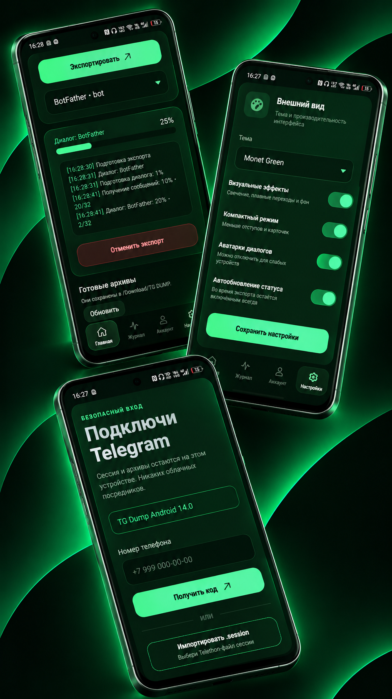
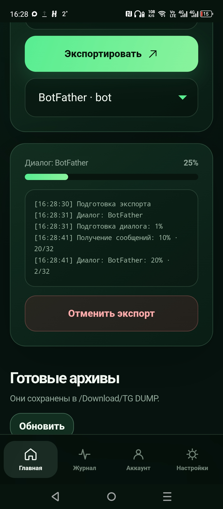
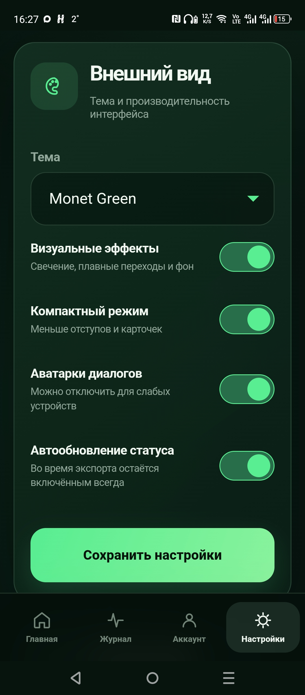
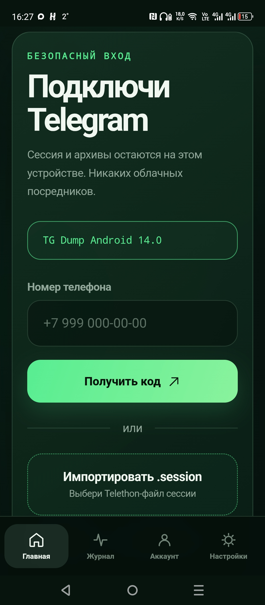

# TG Dump Web 14.0
## 📸 Screenshots










Локальная панель для экспорта Telegram-диалогов, каналов, сообщений и медиа в HTML-архивы.

Проект работает локально и не использует облачное хранилище для дампов. Сессии, конфигурация и экспортированные файлы остаются на устройстве пользователя.

## Android-приложение

Для проекта доступна Android-версия TG Dump:

[Скачать APK в release](https://github.com/Sany0965/TG_DumpPython/releases)

Android-версия запускает TG Dump внутри приложения и предоставляет мобильный интерфейс для работы с Telegram.

> APK предназначен для тестирования. Перед установкой разрешите установку приложений из неизвестных источников, если Android запросит это разрешение.

## Важно для Android-версии

В тестовую Android-версию уже встроены базовые Telegram API ID и API Hash проекта.

Они работают из коробки, поэтому для запуска APK пользователю не нужно самостоятельно заполнять `config.json`.

> Важно: встроенные API-данные являются общими для этой сборки. Не извлекайте и не распространяйте их отдельно. Для собственных проектов рекомендуется использовать собственные API ID и API Hash.

## Подключение из России

Для пользователей из России подключение к Telegram может работать нестабильно или быть недоступно напрямую.

В таком случае перед запуском приложения рекомендуется включить VPN с сервером за пределами России.

VPN желательно включить:

- до авторизации по номеру телефона;
- до импорта `.session`;
- до начала экспорта диалогов и медиа;
- на всё время работы приложения.

Если VPN отключится во время работы, Telegram-соединение или экспорт могут прерваться.

## Возможности

### Авторизация

- вход по номеру телефона;
- ввод кода подтверждения из Telegram;
- поддержка пароля двухэтапной проверки 2FA;
- импорт Telethon-файла `.session`;
- восстановление сохранённой сессии после перезапуска;
- безопасный выход через отключение клиента без отзыва Telegram-сессии;
- экспорт текущей Telegram-сессии.

Пример имени экспортированной сессии:

```text
7968913747.session
```

### Экспорт

- экспорт отдельных диалогов;
- экспорт всех личных чатов;
- экспорт каналов;
- экспорт «Избранного» / Saved Messages;
- экспорт информации об аккаунте;
- сохранение сообщений в HTML;
- загрузка фото, видео, аудио, документов и других медиа;
- отображение процента выполнения;
- счётчик обработанных сообщений;
- отмена текущего экспорта;
- удаление незавершённых временных файлов;
- читаемые имена созданных архивов.

### Android-уведомления

Во время экспорта в статус-баре Android отображается:

- название текущего экспорта;
- процент выполнения;
- кнопка отмены.

После завершения экспорта появляется уведомление:

```text
Экспорт завершён
```

### Хранение файлов

В Android-версии экспортированные файлы сохраняются в:

```text
/storage/emulated/0/Download/TG DUMP
```

Доступны следующие действия:

- открытие папки с экспортом через системный файловый менеджер;
- удаление экспорта из приложения;
- удаление соответствующей копии из папки `Download/TG DUMP`;
- экспорт текущего `.session` в папку `Download/TG DUMP`.

### Интерфейс

- адаптивная панель для компьютеров и смартфонов;
- мобильная Android-версия;
- страницы:
  - Главная;
  - Журнал;
  - Аккаунт;
  - Настройки;
- встроенные SVG-иконки;
- темы Monet Green, Graphite и Ocean Blue;
- компактный режим;
- отключение визуальных эффектов;
- управление отображением аватарок;
- автообновление статуса операции;
- уведомление при отсутствии подключения к интернету;
- длинные пути и сообщения корректно переносятся внутри карточек.

## Изменения в версии 14.0

- добавлен обновлённый мобильный интерфейс;
- вкладка «Автор» переименована в «Аккаунт»;
- добавлены темы Graphite и Ocean Blue;
- добавлены встроенные SVG-иконки;
- исправлен выход из аккаунта без отзыва Telegram-сессии;
- исправлена работа с `.session`;
- добавлен экспорт текущей Telegram-сессии;
- исправлен экспорт каналов без аватарки;
- исправлена обработка имён файлов из Telegram;
- исправлены длинные строки в журнале и карточке прогресса;
- добавлена атомарная публикация экспорта через временную `.partial`-папку;
- отмена удаляет незавершённые файлы;
- добавлена Android-оболочка с WebView и встроенным Python-сервером;
- добавлены уведомления прогресса Android;
- добавлено уведомление о завершении экспорта;
- добавлено открытие папки `Download/TG DUMP`;
- добавлено удаление экспортов из приложения и общего хранилища;
- добавлено предупреждение при отсутствии интернет-соединения;
- ссылка на GitHub открывается во внешнем браузере устройства.

## Структура проекта

```text
TG_DumpPython/
├── app.py
├── web_app.py
├── channel.py
├── utils.py
├── index.py
├── info.py
├── css.py
├── requirements.txt
├── config.example.json
├── start.bat
├── start.sh
└── web/
    ├── index.html
    └── static/
```

## Установка на Windows

Установите Python 3.10 или новее:

[Скачать Python](https://www.python.org/downloads/)

Затем выполните:

```bash
git clone https://github.com/Sany0965/TG_DumpPython.git
cd TG_DumpPython
python -m venv .venv
.venv\Scripts\pip install -r requirements.txt
```

Создайте конфигурацию:

```bash
copy config.example.json config.json
```

Укажите в `config.json` собственные API ID и API Hash, полученные на:

[my.telegram.org](https://my.telegram.org)

Запустите приложение:

```bash
python app.py
```

Также можно запустить:

```text
start.bat
```

После запуска откройте адрес, который появится в консоли.

## Установка в Pydroid 3

1. Скачайте или клонируйте репозиторий.
2. Распакуйте весь проект в одну папку.
3. Убедитесь, что рядом с `app.py` находятся:
   - `web_app.py`;
   - `index.py`;
   - `utils.py`;
   - `channel.py`;
   - `info.py`;
   - `css.py`;
   - папка `web`.
4. Установите зависимости:

```bash
pip install -r requirements.txt
```

5. Создайте `config.json` на основе `config.example.json`.
6. Укажите собственные API ID и API Hash.
7. Запустите:

```bash
python app.py
```

8. Откройте адрес вида:

```text
http://127.0.0.1:8080
```

Не запускайте только отдельный `app.py` и не открывайте `web/index.html` напрямую.

Если появился `Failed to fetch`:

- убедитесь, что `app.py` всё ещё запущен;
- подождите несколько секунд;
- обновите страницу;
- проверьте, что открыт адрес локального сервера, а не файл `web/index.html`.

## Linux / Android Rootfs

```bash
chmod +x start.sh
./start.sh
```

## Ручной запуск

```bash
python -m venv .venv
```

Windows:

```bash
.venv\Scripts\pip install -r requirements.txt
```

Linux:

```bash
.venv/bin/pip install -r requirements.txt
```

Запуск:

```bash
python app.py
```

## Конфигурация

Пример конфигурации:

```json
{
  "api_id": 0,
  "api_hash": "YOUR_API_HASH",
  "app_title": "Telegram Export Suite",
  "app_version": "14.0",
  "device_model": "TG Dump Web",
  "system_version": "Windows / Android",
  "lang_code": "ru",
  "system_lang_code": "ru-RU",
  "ui": {
    "theme": "monet",
    "effects": false,
    "compact": false,
    "avatars": true,
    "auto_refresh": true
  }
}
```

Получить API ID и API Hash можно на:

https://my.telegram.org

## Безопасность

Файл `.session` является ключом доступа к Telegram-аккаунту.

Не публикуйте:

```text
config.json
*.session
*.session-journal
runtime/
TG_DumpExports/
.venv/
*.apk
*.aab
```

Для публичного GitHub используйте только:

```text
config.example.json
```

без настоящего API Hash.

APK из тестового релиза содержит рабочие базовые API-данные для удобного запуска Android-версии. Не извлекайте и не распространяйте эти данные отдельно.

Если API Hash или файл `.session` уже попал в публичный репозиторий, рекомендуется:

1. перевыпустить API-данные на `my.telegram.org`;
2. завершить подозрительные Telegram-сессии;
3. удалить секретные файлы из истории Git;
4. собрать новый APK с обновлёнными данными.

## Хранение экспортов

В веб-версии архивы хранятся в отдельной папке:

```text
TG_DumpExports/
```

В Android-версии экспортированные файлы сохраняются в:

```text
Download/TG DUMP/
```

Telegram-сессия сохраняется в папке приложения и может быть экспортирована пользователем вручную в:

```text
Download/TG DUMP/<telegram_id>.session
```

## Android APK

Тестовая сборка:

[Скачать release.beta.0.1.apk in release](https://github.com/Sany0965/TG_DumpPython/releases)

Требования:

- Android 7.0 или новее;
- архитектура `arm64-v8a`;
- доступ к интернету для подключения к Telegram;
- разрешение на уведомления для отображения прогресса экспорта;
- VPN для пользователей из России при проблемах с подключением к Telegram.

## Автор

- GitHub: [Sany0965](https://github.com/Sany0965)
- Репозиторий: [TG_DumpPython](https://github.com/Sany0965/TG_DumpPython)
- Telegram: [@worpli](https://t.me/worpli)
- Сайт: [sany0965.github.io](https://sany0965.github.io/)

## Лицензия

Проект распространяется согласно условиям лицензии, указанной в файле [LICENSE](LICENSE).
